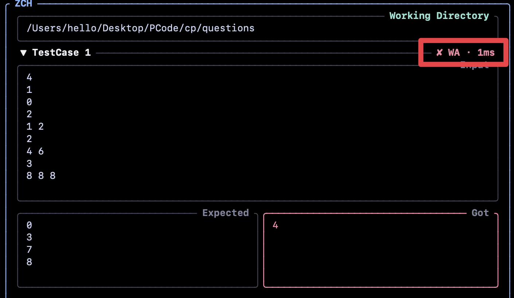

# 🚀 ZCH

**A blazing-fast TUI dashboard for competitive programming in the [Zed](https://zed.dev/) editor on macOS.**

[](#)
[](#)
[](#)

A single Rust binary that receives problems from the [Competitive Companion](https://github.com/jmerle/competitive-companion) extension, runs your samples with precise timings, and submits to **Codeforces** via Safari automation — all from one local TUI.

---

## ✨ Features

* 🖥️ **Live TUI dashboard** — a quiet workspace bar, live pass/fail summary, clear Input / Expected / Actual cards, and contextual shortcuts that keep their labels in narrow editor splits. Blue marks focus; verdict colors mark results. The welcome screen gives three next steps and stays still while idle.
* ✔️ **Instant verdicts** — each test case gets a chip (`✔ AC · 4 ms`, `✘ WA`, `⏱ TLE`, `✘ RE`, `✘ CE`) and auto-collapses on AC; on WA the **Actual** box marks the exact characters that differ in red.
* 📥 **Auto-parses problems** — payloads are captured on `127.0.0.1:10043`; the file is created from `~/.zch/boilerplate.cpp` with a `// URL:` header, tests live in `~/.zch/.tc/`, and the file opens in Zed automatically.
* ⚡ **Blazing fast execution** — compiles once and caches the binary by source hash + flags, so unchanged code replays every case instantly with 1ms polling, per-case timing, and hard TLE kills. Live `compiling… → running case i/n` phases show where the time goes.
* 🤖 **One-key Codeforces submissions** — a confirmation modal shows every detail, then async verdicts stream into the **Submissions bar** (`⠹ submitting · 12s`, then `✔` in green for accepted, yellow for pretest passed, `✘` in red for rejected). Safari tabs are tracked by URL (**INTERRUPTED** / **TIMED OUT** / hard 5-minute timeout handled) and CAPTCHAs raise the window automatically. Everything stays inside the TUI.
* 🎛️ **Command palette from Zed** — Zed tasks drive the running TUI over HTTP (`send r`, `send s`, …) with the active `${ZED_FILE}`; `zch send` reports real success/failure reasons.
* 📁 **Live directory switching** — `cd`, `ls`, `pwd` console with TAB completion cycling and `↑`/`↓` command history; new problems are saved wherever you point it.
* 🧩 **Multi-language, no hidden flags** — C++, Python 3, Java. Nothing is added behind your back: `-O2`, `-std=c++20`, `-include-pch`, … are entered as individually validated tags in the `c` menu (each language keeps its own list), and the Codeforces language id follows your `-std=` tag.

---

## 📋 Prerequisites

- **macOS** *(relies on native Apple Events for Safari automation)*
- A **Nerd Font** in your terminal (e.g. JetBrainsMono Nerd Font) so the file/folder icons render the same on every machine.
- **Safari** with **"Allow JavaScript from Apple Events"** enabled:
  - `Safari` → `Settings` → `Advanced` → check `"Show features for web developers"`
  - `Develop` → `Allow JavaScript from Apple Events`
- **[Zed Code Editor](https://zed.dev/)**
- **C++ compiler** (`g++` via Homebrew, or Apple Clang)
- **[Competitive Companion](https://github.com/jmerle/competitive-companion)** browser extension.

> **💡 Why Safari only?**
> Submission automation requires the browser to run JavaScript in the background without stealing focus. **Only Safari supports this natively** via AppleScript. Other browsers would foreground the window mid-solve.

---

## 🛠️ Installation

### 1. Install

**Homebrew (recommended):**

```bash
brew install prsweet/tap/zch
```

**Or:**

```bash
curl -fsSL https://github.com/prsweet/zch/releases/latest/download/zch-installer.sh | sh
```

### 2. Setup Zed tasks

Append to `~/.config/zed/tasks.json` (press `cmd+shift+R` to spawn tasks):

```json
[
  {
    "label": "CP: Start Listener (Current Folder)",
    "command": "zch",
    "use_new_terminal": true,
    "allow_concurrent_runs": false,
    "hide": "never",
    "reveal_target": "center"
  },
  {
    "label": "CP: Run Tests",
    "command": "zch send r \"${ZED_FILE}\"",
    "use_new_terminal": false,
    "allow_concurrent_runs": false,
    "reveal": "never",
    "hide": "always"
  },
  {
    "label": "CP: Submit to Codeforces",
    "command": "zch send s \"${ZED_FILE}\"",
    "use_new_terminal": false,
    "allow_concurrent_runs": false,
    "reveal": "never",
    "hide": "always"
  }
]
```

### 3. Optimize your keymap

Add to `~/.config/zed/keymap.json`:

```json
[
  {
    "context": "Editor",
    "bindings": {
      "cmd-'": ["task::Spawn", { "task_name": "CP: Run Tests" }],
      "cmd-enter": ["task::Spawn", { "task_name": "CP: Submit to Codeforces" }],
      "cmd-r": ["workspace::SendKeystrokes", "cmd-alt-shift-r cmd-\\"]
    }
  },
  {
    "context": "Workspace",
    "bindings": {
      "cmd-alt-shift-r": ["task::Spawn", { "task_name": "CP: Start Listener (Current Folder)" }]
    }
  }
]
```

The `cmd-r` macro spawns the dashboard in the center pane and then splits the pane right (`cmd-\` is Zed's built-in *Split Right*), so the TUI lands beside your code — no dock settings touched.

---

## 🎮 Usage

### 1. Start the TUI

Press **`cmd-r`** inside your problems folder (or run `zch` in a terminal). The keymap macro opens the dashboard split to the right of your editor; it listens on `127.0.0.1:10043`.

### 2. Receive a problem

Click the **Competitive Companion** extension on any Codeforces problem page. The file is created in the current directory, saved to the test database, and opened in Zed automatically. Problems that sanitize to the same filename (for example `A. Sum` in two different contests) get a short URL suffix, so their test databases and compiled binaries never overwrite each other.

### 3. Test & submit from the TUI

| Key | Action |
| --- | --- |
| `r` | compile (cached when unchanged) & run all test cases |
| `a` | add a custom test case |
| `x` | delete a test case: `Tab`/`Shift+Tab` selects, `Enter` confirms |
| `e` | edit existing test cases |
| `s` | submit to Codeforces (confirmation modal → Enter submits / Esc or Backspace cancels) |
| `d` | console: `cd <path>` · `ls` · `pwd` (`TAB` completes and cycles, `↑`/`↓` recall history) |
| `c` | config: language, validated compile-flag tags, and theme (`Tab` moves fields; `←`/`→` or clicking a choice switches language or theme) |
| `Esc` | cancel a running test, if one is in flight |
| `h` / `F1` | open the key map (`h`, `F1`, or `Esc` closes); `F1` also works while typing |
| `PgUp` / `PgDn` | scroll the test list in Normal mode |
| `Home` / `End` | jump to the top / bottom of the test list in Normal mode |
| `q` | quit |

While editing, `Tab`/`Shift+Tab` switch between **Input** / **Expected**; in edit mode they continue through the other cases, while a newly added case keeps focus inside its own two panes. `F1` opens the key map while typing, and `Esc` saves. Both edit and delete modes expand every case, so nothing is hidden behind a collapsed card. `Tab`/`Shift+Tab` are the only focus-navigation keys; arrow keys never move focus or walk a list. The active pane is kept inside the viewport and scrolls internally when the text is longer, so the cursor never runs off-screen; pane heights do not change when you switch focus. The console keeps a fixed one-line layout for the live status, latest result, or error, so status updates never resize the rest of the UI. The footer prioritizes labeled actions for the current mode; narrow panes keep the Escape action visible. Normal mode lists `h` for help. `F1` opens help while typing; `h` also opens it in non-typing modes. Help scrolls with the wheel, arrow keys, or Page Up / Page Down and closes with `h`, `F1`, or `Esc`. The mouse wheel scrolls the focused textarea, and anywhere else it scrolls the case list. Scrollbars are one cell wide and draggable too: the case list, submissions panel, config flags, and the pane dialog (both axes) support wheel, track click, and smooth thumb drag. A stable summary above the case list shows failed, passed, and pending counts, plus language and time limit when space allows. A hairline separates the list from the status panel below. The list reserves a scrollbar column only when it overflows.

`r` also works for a file with no stored cases: it adds one in-memory smoke case (empty input/expected) so you still get a compile + crash check. Only one run can be active; `Esc`, editing, deleting, or receiving a new problem cancels it and kills the whole child process group instead of leaving it running in the background.

In the config menu (`c`), extra flags are **tags**, not one free-form line: type a flag and press `Enter` to add it. Tags are checked (they must start with `-`, duplicates and unknown `-std=` versions such as `-std=c++1000` are rejected) and stored per language in `~/.zch/config.json`, so switching the language switches the flag list with it. A value that belongs to a flag (`-include-pch /path/to.pch`) is added as its own tag right after that flag. The list shows one tag per line — up to eight at once, with a draggable scrollbar. Before `x` the list is read-only; `x` starts the select → `Enter` → confirm → `Enter` flow and `Tab`/`Shift+Tab` walks the tags. Deleting either half of a `-include-pch` pair removes both halves. No `-std`, `-O2`, or warning flags are added implicitly; the Codeforces language id is derived from the last `-std=` tag (C++17 → 54, C++20 → 89, C++23 → 91). `Tab` once more reaches **Theme**. `←`/`→` switch between Mocha and `prsweet's favourite`, the choice is saved in the same config file, and the palette applies immediately.

Pressing `x` on a test case enters delete mode: every case expands, the focused card keeps its verdict visible and shows a red `× delete` marker after the case name, and the other cards dim. `Tab`/`Shift+Tab` walk the list, `Enter` opens a confirmation modal showing the case's input and expected output, and only `Enter` there deletes — `Backspace` goes back, `Esc` cancels. Double-click **Input**, **Expected**, or **Actual** to open that pane in a large scrollable dialog with thin, padded, draggable vertical and horizontal scrollbars; safe output keeps its red diff, huge output opens a paged view with a per-page diff, and `Esc` closes it. The final run summary reports `compiled in Xms` or `compile skipped` and the runner-measured total wall time, so both compile and run cost are never hidden.

Outside edit mode panes truncate instead of scrolling: raw output is cut to a ~24 KB preview as soon as a result arrives, the pane shows at most 300 lines / 24k characters, and huge WA output skips the character diff in favor of a plain preview plus an `… output truncated` / `… diff skipped for large output` note. Lines wider than the pane end in `…`. While editing, the focused pane scrolls internally, and the large pane dialog scrolls with the wheel, `↑`/`↓`/`←`/`→`/`PgUp`/`PgDn`, or by clicking or dragging its vertical or horizontal scrollbar; it keeps the full output (with the full diff for safe WA results) in memory up to 10 MB / 20,000 lines. Anything larger is spilled to a temp file and read page by page, with the diff recomputed for the visible page; only a spill failure falls back to the bounded preview and warning.

### 4. Test & submit from Zed

* **Run (`cmd-'`)** — asks the running TUI to load `${ZED_FILE}` and run it. If the file has no stored cases, the TUI smoke-runs it with empty input.
* **Submit (`cmd-enter`)** — asks the running TUI to load `${ZED_FILE}` and open the submission confirmation modal. `Enter` submits from there, `Backspace` cancels, and progress stays in the Submissions bar.

The `send` subcommand talks to the TUI over HTTP and prints the real result (or the reason it was refused):

```bash
zch send r /path/to/Problem.cpp   # run
zch send s /path/to/Problem.cpp   # open the confirmation modal in the TUI
```

Set `ZCH_PORT` to run on a different port than `10043`.

---

## 🛡️ Dealing with CAPTCHAs

Codeforces occasionally serves an invisible CAPTCHA. When automation hits one, the TUI alerts you (`⚠ CAPTCHA — solve it, submission continues automatically`) and Safari foregrounds itself. Solve it, and the live verdict polling resumes on its own.

---

## 🧱 Architecture

```
src/
  main.rs               — event loop: one channel, four actors
  helper.rs             — UI state machine (input modes, commands, verdicts)
  components/           — ratatui widgets
    dir_terminal.rs     — working-directory console (cd/ls/pwd, completion cycling, history)
    tc_list.rs          — scrollable test case list with verdict chips
    testcase.rs         — one case: input / expected / actual, diff highlighting
    config.rs           — responsive language, flag, and theme settings
    splash.rs           — empty-state screen
  core/
    receiver.rs         — Competitive Companion HTTP listener (:10043) + command API
    runner.rs           — content-hash compile cache + run all cases (timings, TLE kills)
    submitter.rs        — Safari AppleScript automation + platform detection
    fs_ops.rs           — boilerplate, test DB, config, binary pruning
  error.rs              — shared error type
```

Everything runs on one channel: the UI thread owns all state, and the receiver / runner / submitter workers only exchange `PassingCommand` envelopes with it — no worker holds a handle to another.

To inspect the UI without starting the listener or submitting anything, render the terminal-size and mode checks:

```bash
ZCH_DUMP=1 cargo test renders_supported_sizes_and_modes -- --nocapture
```

Set `ZCH_PREVIEW_DIR=/tmp/zch-preview` on the same command to also export styled HTML from the actual terminal cells. The checks cover welcome, verdicts, editing, settings, and deletion at widths from 120 columns down to tiny resize states.


---

## 💡 Pro-tips for maximum performance



### 1. Drop execution latency to 3-4ms ⚡

macOS security scans (`syspolicyd`) add ~200ms of lag when running newly compiled binaries. Fix:

1. **System Settings** → **Privacy & Security** → **Developer Tools**: add **Zed** and your terminal emulator, toggle them **ON**.
2. Add the same under **Full Disk Access**.

### 2. Ultra-fast precompiled headers (PCH) 🔥

Compiling `#include <bits/stdc++.h>` is usually the bulk of a cold run; a
precompiled header shared between runs cuts it down noticeably (roughly
0.3s → 0.1s on an M-series Mac). zch itself adds no flags — a PCH only helps if
you pass `-include-pch` yourself.

**For Clang (macOS default), with a C++23 PCH:**

```bash
clang++ -std=c++23 -x c++-header /usr/local/include/bits/stdc++.h \
  -o /usr/local/include/bits/stdc++.h.pch
```

`/usr/local/include/bits/stdc++.h` is not shipped by macOS; create it (the
[std-with-pbds](https://github.com/prsweet/std-with-pbds.git) repo does) and
expect to need `sudo` for `/usr/local/include`.

Then open the config menu (`c`), switch to the flags field, and add these tags
in this order (one `Enter` each):

```
-std=c++23
-O2
-include-pch
/usr/local/include/bits/stdc++.h.pch
```

The standard, architecture, and compiler version must match the PCH exactly;
after an Xcode/Clang update, rebuild it. Homebrew GCC does **not** accept a
Clang-built PCH, so drop `-include-pch` (and rebuild with GCC) if `g++` is real
GCC.

### 3. Fast policy-based data structures (PBDS) on Clang 🌲

Apple Clang doesn't ship bits/stdc++.h or PBDS. The [std-with-pbds](https://github.com/prsweet/std-with-pbds.git) helper repo sets up both for Apple Clang.
