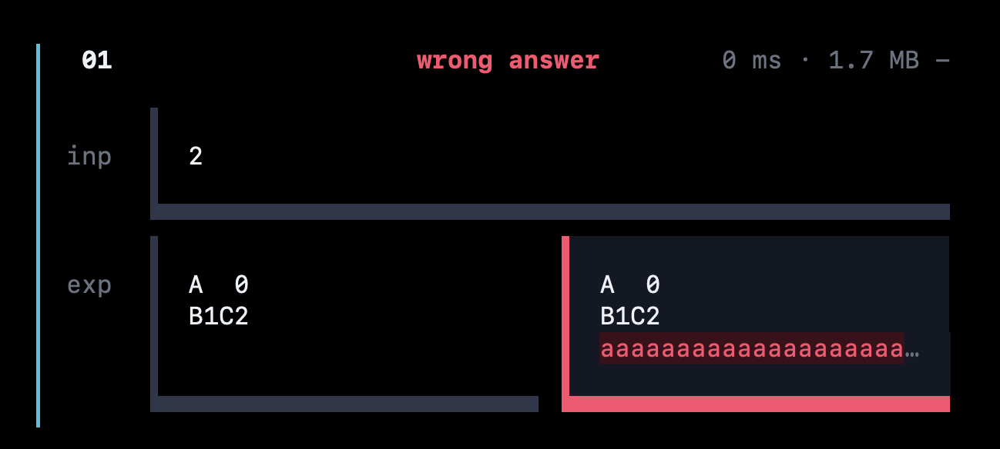

# 🚀 ZCH

**A blazing-fast TUI dashboard for competitive programming in the [Zed](https://zed.dev/) editor on macOS.**

[](#)
[](#)
[](#)

A single Rust binary that receives problems from the [Competitive Companion](https://github.com/jmerle/competitive-companion) extension, runs your samples with precise timings, and submits to **Codeforces** via Safari automation — all from one local TUI.

---

## ✨ Features

* 🖥️ **A calm, single-column dashboard** — an app bar with the loaded problem, a folder row, the case list, a submissions band, and one console line at the bottom with the mode badge, the latest message and that mode's keys. Nothing is boxed inside a box; motion is short and eased, and `ZCH_REDUCED_MOTION=1` turns it off.
* 🎨 **Four themes** — **prsweet** (pure black with Zed syntax colours, the default), **catppuccin** (Mocha), **obsidian** (graphite and periwinkle) and **daylight** (light). Switch live from the config sheet (`c`); every text colour is checked for legible contrast on its background.
* ✔️ **Clear verdicts** — each case header centres its verdict (`accepted`, `wrong answer`, `time limit exceeded`, `runtime error`, `output limit exceeded`, `compilation error`) with time and memory on the right. Input, expected and got sit in their own padded boxes; the got box is framed in the verdict's colour, and a wrong answer marks the exact characters that differ. Accepted cases collapse on their own; `+` / `-` on a header folds it by hand.
* 🔍 **See anything that was cut short** — wherever text did not fit (a long line in a case box, capped output, a config error, a console message, a submission, a file listing), **double-click it** to open the whole thing in a scrollable viewer. Text that already fits opens nothing.
* 📥 **Auto-parses problems** — payloads are captured on `127.0.0.1:10043`; the file is created from `~/.zch/boilerplate.cpp` with a `// URL:` header, tests live in `~/.zch/.tc/`, and the file opens in Zed automatically.
* ⚡ **Fast execution** — compiles once and caches the binary by source hash + flags, so unchanged code replays every case instantly with per-case timing, peak memory, and hard TLE kills. A progress rule under the header shows where the run is.
* ⚖️ **Judge-like checking** — token (default), line, case-insensitive, floating-point (`epsilon`) or a custom testlib-style checker, set globally or per problem.
* 💬 **Interactive sessions** — a problem with no samples runs live on a real pseudo-terminal: prompts appear immediately, `Enter` sends a line, `Ctrl-D` / `Ctrl-C` behave like a terminal, and the transcript scrolls.
* 🤖 **One-key Codeforces submissions** — a confirmation sheet shows every detail, then verdicts stream into the submissions band (`✔` accepted, yellow for pretests passed, `✘` rejected). Safari tabs are tracked by URL, CAPTCHAs raise the window, and a Codeforces **403 / 429** page is detected and reported instead of polling forever.
* 📋 **Mouse-first where it helps** — drag to select text inside any panel and release to copy it; every scrollbar is draggable; the wheel scrolls whatever is under the pointer.
* 🎛️ **Driven from Zed** — Zed tasks talk to the running TUI over HTTP (`zch send r`, `zch send s`) with the active `${ZED_FILE}`, and `zch send` prints the real result.
* 📁 **Directory console** — `cd`, `ls`, `pwd` with TAB completion and `↑` / `↓` history; new problems are saved wherever you point it.
* 🧩 **Multi-language, no hidden flags** — C++, Python 3, Java. Nothing is added behind your back: `-O2`, `-std=c++20`, `-include-pch`, … are validated tags in the config sheet (each language keeps its own list), and the Codeforces language id follows your `-std=` tag.

---

## 📋 Prerequisites

- **macOS** *(relies on native Apple Events for Safari automation)*
- A **Nerd Font** in your terminal (e.g. JetBrainsMono Nerd Font) so the file/folder icons render the same on every machine.
- **Safari** with **"Allow JavaScript from Apple Events"** enabled:
  - `Safari` → `Settings` → `Advanced` → check `"Show features for web developers"`
  - `Develop` → `Allow JavaScript from Apple Events`
- **[Zed Code Editor](https://zed.dev/)**
- **C++ compiler** (`g++` via Homebrew, or Apple Clang)
- **[Competitive Companion](https://github.com/jmerle/competitive-companion)** browser extension.

> **💡 Why Safari only?**
> Submission automation requires the browser to run JavaScript in the background without stealing focus. **Only Safari supports this natively** via AppleScript. Other browsers would foreground the window mid-solve.

---

## 🛠️ Installation

### 1. Install

**Homebrew (recommended):**

```bash
brew install prsweet/tap/zch
```

**Or:**

```bash
curl -fsSL https://github.com/prsweet/zch/releases/latest/download/zch-installer.sh | sh
```

### 2. Setup Zed tasks

Append to `~/.config/zed/tasks.json` (press `cmd+shift+R` to spawn tasks):

```json
[
  {
    "label": "CP: Start Listener (Current Folder)",
    "command": "zch",
    "use_new_terminal": true,
    "allow_concurrent_runs": false,
    "hide": "never",
    "reveal_target": "center"
  },
  {
    "label": "CP: Run Tests",
    "command": "zch send r \"${ZED_FILE}\"",
    "use_new_terminal": false,
    "allow_concurrent_runs": false,
    "reveal": "never",
    "hide": "always"
  },
  {
    "label": "CP: Submit to Codeforces",
    "command": "zch send s \"${ZED_FILE}\"",
    "use_new_terminal": false,
    "allow_concurrent_runs": false,
    "reveal": "never",
    "hide": "always"
  }
]
```

### 3. Optimize your keymap

Add to `~/.config/zed/keymap.json`:

```json
[
  {
    "context": "Editor",
    "bindings": {
      "cmd-'": ["task::Spawn", { "task_name": "CP: Run Tests" }],
      "cmd-enter": ["task::Spawn", { "task_name": "CP: Submit to Codeforces" }],
      "cmd-r": ["workspace::SendKeystrokes", "cmd-alt-shift-r cmd-\\"]
    }
  },
  {
    "context": "Workspace",
    "bindings": {
      "cmd-alt-shift-r": ["task::Spawn", { "task_name": "CP: Start Listener (Current Folder)" }]
    }
  }
]
```

The `cmd-r` macro spawns the dashboard in the center pane and then splits the pane right (`cmd-\` is Zed's built-in *Split Right*), so the TUI lands beside your code — no dock settings touched.

---

## 🎮 Usage

### 1. Start the TUI

Press **`cmd-r`** inside your problems folder (or run `zch` in a terminal). The keymap macro opens the dashboard split to the right of your editor; it listens on `127.0.0.1:10043`.

### 2. Receive a problem

Click the **Competitive Companion** extension on any Codeforces problem page. The file is created in the current directory, saved to the test database, and opened in Zed automatically. Problems that sanitize to the same filename (for example `A. Sum` in two different contests) get a short URL suffix, so their test databases and compiled binaries never overwrite each other.

### 3. Test & submit from the TUI

The console always shows the keys of the mode you are in; `Ctrl-H` (or `F1`) opens them as a sheet.

| Key | Action |
| --- | --- |
| `r` | compile (cached when unchanged) & run every case — or start an interactive session when the problem has no samples |
| `a` | add a case |
| `e` | edit cases (`Tab` / `Shift+Tab` move between panes and cases, `Esc` saves) |
| `x` | delete a case: `Tab` / `Shift+Tab` select, `Enter` opens the confirmation, `Enter` again deletes |
| `s` | submit to Codeforces (`Enter` submits, `Esc` / `Backspace` cancels) |
| `d` | directory console: `cd <path>` · `ls` · `pwd` |
| `c` | config: language, compile-flag tags, theme |
| `m` | messages: everything the console said this session |
| `Esc` | cancel a running test |
| `Ctrl-H` / `F1` | keys for the current mode |
| `q` | quit (asks first while a submission is still being judged) |

**Mouse.** Click a case to select it, and click `+` / `-` on its header to fold it. Double-click anything shown cut short to read it whole. The viewer scrolls with the wheel, `↑` / `↓`, `←` / `→` and `PgUp` / `PgDn`, has draggable scrollbars on both axes, and closes with `Esc`. Drag across text to copy it.

**Editing.** Only the box being typed into scrolls; every other box shows its content and marks a line that runs past the edge with `…`. Box heights follow the content, never the focus, so `Tab` does not make the layout jump.

**Large output.** Results are cut to a ~24 KB preview as soon as they arrive, and a box shows at most 300 lines / 24k characters, ending with a note such as `… 812 more lines hidden`. The viewer keeps the full output (with the full diff for a wrong answer) up to 10 MB / 20,000 lines. Anything larger is spilled to a temp file and read page by page, with the diff recomputed for each page.

**Interactive sessions.** `r` on a problem with no cases starts the program on a pseudo-terminal. `Enter` focuses the input and sends a line, `Ctrl-D` sends end-of-input, `Ctrl-C` interrupts, `PgUp` / `PgDn` scroll, and `Esc` steps back (twice stops the program but keeps the transcript). The transcript is bounded (2,000 lines / 8 MB) and escape sequences are stripped. Only one run is active at a time; editing, deleting or receiving a new problem cancels it and kills the whole process group.

**Config (`c`).** `Tab` moves between **language**, **compile flags** and **theme**; `←` / `→` change the language or theme (the theme previews live). Flags are tags: type one and press `Enter`. They must start with `-`; duplicates and unknown `-std=` versions are rejected, and a value that belongs to a flag (`-include-pch /path/to.pch`) becomes its own tag right after it. `x` starts the select → confirm delete flow, and deleting either half of an `-include-pch` pair removes both. Nothing is added implicitly; the Codeforces language id comes from the last `-std=` tag (C++17 → 54, C++20 → 89, C++23 → 91). Everything is saved to `~/.zch/config.json`, which also takes:

```json
{
  "theme": "daylight",
  "checker": { "mode": "float", "epsilon": 1e-6 },
  "time_limit_multiplier": 1.5
}
```

`checker.mode` is one of `tokens` (default), `lines`, `case_insensitive`, `float` or `custom` (`{ "mode": "custom", "command": "./check" }`, run as `<command> <input> <output> <answer>`, exit code 0 accepts).

### 4. Test & submit from Zed

* **Run (`cmd-'`)** — asks the running TUI to load `${ZED_FILE}` and run it. If the file has no stored cases, the TUI opens an interactive session for it instead.
* **Submit (`cmd-enter`)** — asks the running TUI to load `${ZED_FILE}` and open the submission confirmation modal. `Enter` submits from there, `Backspace` cancels, and progress stays in the Submissions bar.

The `send` subcommand talks to the TUI over HTTP and prints the real result (or the reason it was refused):

```bash
zch send r /path/to/Problem.cpp   # run
zch send s /path/to/Problem.cpp   # open the confirmation modal in the TUI
```

### Environment

| Variable | Effect |
| --- | --- |
| `ZCH_PORT` | listen on a port other than `10043` |
| `ZCH_REDUCED_MOTION=1` / `ZCH_ANIMATIONS=off` | no transitions, static spinners |
| `ZCH_COLOR=truecolor` / `256` | force the colour depth when detection guesses wrong |
| `NO_COLOR` | honoured; every state is also told by a word or glyph |

---

## 🛡️ Dealing with CAPTCHAs

Codeforces occasionally serves an invisible CAPTCHA. When automation hits one, the TUI alerts you and Safari foregrounds itself. Solve it, and the live verdict polling resumes on its own.

If Codeforces answers **403 Forbidden** (or **429** for too many requests), the submission is marked **blocked** instead of waiting for a verdict that will never come. Before the code was sent, nothing was submitted; after, the tab is left open so you can check the verdict on the site.

---

## 🧱 Architecture

```
src/
  main.rs              — event loop: one channel, four actors
  error.rs             — shared error type
  helper/              — all UI state, owned by the main thread
    run.rs             — running cases, verdicts, the run summary
    cases.rs           — adding, editing, deleting and saving cases
    submit.rs          — the submit sheet and each submission's progress
    problem.rs         — the loaded problem, `zch send` replies
    session.rs         — interactive programs for problems without samples
    dialog.rs          — the viewer: double-click to read anything cut short
    selection.rs       — mouse selection and the clipboard
    input.rs           — keyboard and mouse dispatch
    view/              — everything drawn (chrome, sheets, transcript, motion)
  components/          — ratatui widgets
    theme.rs           — the four palettes, as semantic colour roles
    ui.rs              — shared primitives: rows, keycaps, sheets, cut-text registry
    tc_list.rs         — the scrolling case list
    testcase.rs        — one case: header, input / expected / got boxes, diff
    config.rs          — language, flag tags, theme
    dir_terminal.rs    — the cd / ls / pwd console
    status.rs          — the console line and the message vocabulary
    motion.rs          — eased, time-based transitions
    splash.rs          — the empty-state screen
  core/
    receiver.rs        — Competitive Companion listener (:10043) + command API
    runner.rs          — content-hash compile cache, runs with timing and memory
    checker.rs         — token / line / float / custom output checking
    submitter.rs       — Safari AppleScript automation, 403 / CAPTCHA handling
    fs_ops.rs          — boilerplate, test DB, config, binary pruning
```

Everything runs on one channel: the UI thread owns all state, and the receiver / runner / submitter workers only exchange `PassingCommand` envelopes with it — no worker holds a handle to another.

---

## 💡 Pro-tips for maximum performance



### 1. Drop execution latency to 3-4ms ⚡

macOS security scans (`syspolicyd`) add ~200ms of lag when running newly compiled binaries. Fix:

1. **System Settings** → **Privacy & Security** → **Developer Tools**: add **Zed** and your terminal emulator, toggle them **ON**.
2. Add the same under **Full Disk Access**.

### 2. Ultra-fast precompiled headers (PCH) 🔥

Compiling `#include <bits/stdc++.h>` is usually the bulk of a cold run; a
precompiled header shared between runs cuts it down noticeably (roughly
0.3s → 0.1s on an M-series Mac). zch itself adds no flags — a PCH only helps if
you pass `-include-pch` yourself.

**For Clang (macOS default), with a C++23 PCH:**

```bash
clang++ -std=c++23 -x c++-header /usr/local/include/bits/stdc++.h \
  -o /usr/local/include/bits/stdc++.h.pch
```

`/usr/local/include/bits/stdc++.h` is not shipped by macOS; create it (the
[std-with-pbds](https://github.com/prsweet/std-with-pbds.git) repo does) and
expect to need `sudo` for `/usr/local/include`.

Then open the config menu (`c`), switch to the flags field, and add these tags
in this order (one `Enter` each):

```
-std=c++23
-O2
-include-pch
/usr/local/include/bits/stdc++.h.pch
```

The standard, architecture, and compiler version must match the PCH exactly;
after an Xcode/Clang update, rebuild it. Homebrew GCC does **not** accept a
Clang-built PCH, so drop `-include-pch` (and rebuild with GCC) if `g++` is real
GCC.

### 3. Fast policy-based data structures (PBDS) on Clang 🌲

Apple Clang doesn't ship bits/stdc++.h or PBDS. The [std-with-pbds](https://github.com/prsweet/std-with-pbds.git) helper repo sets up both for Apple Clang.
