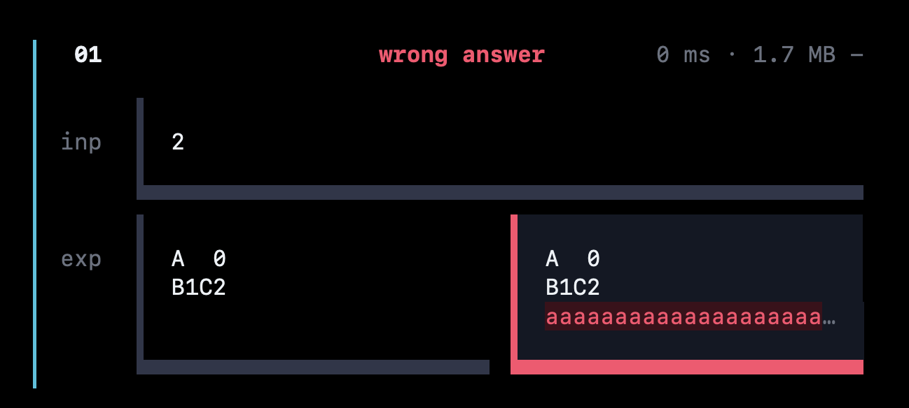

# Performance tips

Back to the [README](../README.md).



zch caches compiled binaries, so a run with unchanged code skips compiling entirely. These tips speed up what is left on macOS.

## 1. Cut the first-run delay of new binaries

macOS security scans (`syspolicyd`) add about 200 ms the first time a freshly compiled binary runs. To skip it:

1. **System Settings** → **Privacy & Security** → **Developer Tools**: add **Zed** and your terminal, and turn them on.
2. Add the same apps under **Full Disk Access**.

With that, a run of a small program takes 3–4 ms.

## 2. Precompile `bits/stdc++.h`

Compiling `#include <bits/stdc++.h>` is most of a cold C++ run. A precompiled header cuts it from roughly 0.3 s to 0.1 s on an Apple Silicon Mac. zch adds no flags itself, so the header only helps if you pass it.

macOS does not ship `/usr/local/include/bits/stdc++.h`; the [std-with-pbds](https://github.com/prsweet/std-with-pbds) repo creates it (you may need `sudo` for `/usr/local/include`). Then build the header with Clang, here for C++23:

```bash
clang++ -std=c++23 -x c++-header /usr/local/include/bits/stdc++.h \
  -o /usr/local/include/bits/stdc++.h.pch
```

Open the config sheet (`c`), go to the flags field, and add these tags in order, pressing `Enter` after each:

```
-std=c++23
-O2
-include-pch
/usr/local/include/bits/stdc++.h.pch
```

The standard, architecture and compiler version must match the header exactly, so rebuild it after an Xcode or Clang update. Homebrew GCC cannot use a Clang-built header: if your `g++` is real GCC, drop `-include-pch` or rebuild the header with GCC.

## 3. Policy-based data structures with Apple Clang

Apple Clang ships neither `bits/stdc++.h` nor the GNU policy-based data structures (PBDS). [std-with-pbds](https://github.com/prsweet/std-with-pbds) sets up both.
